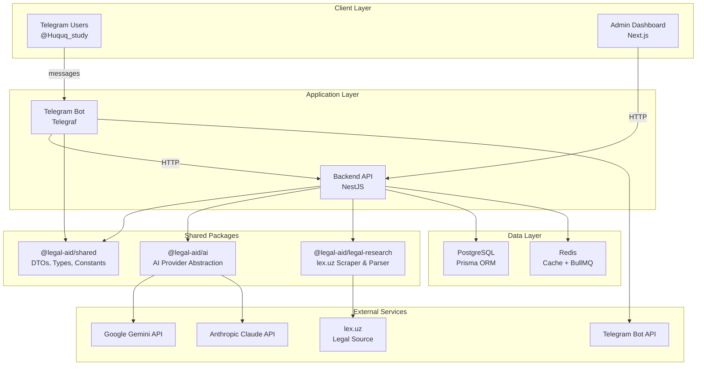
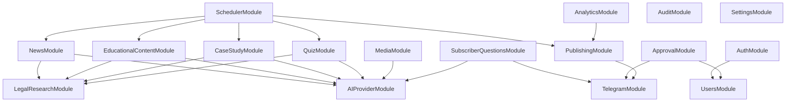
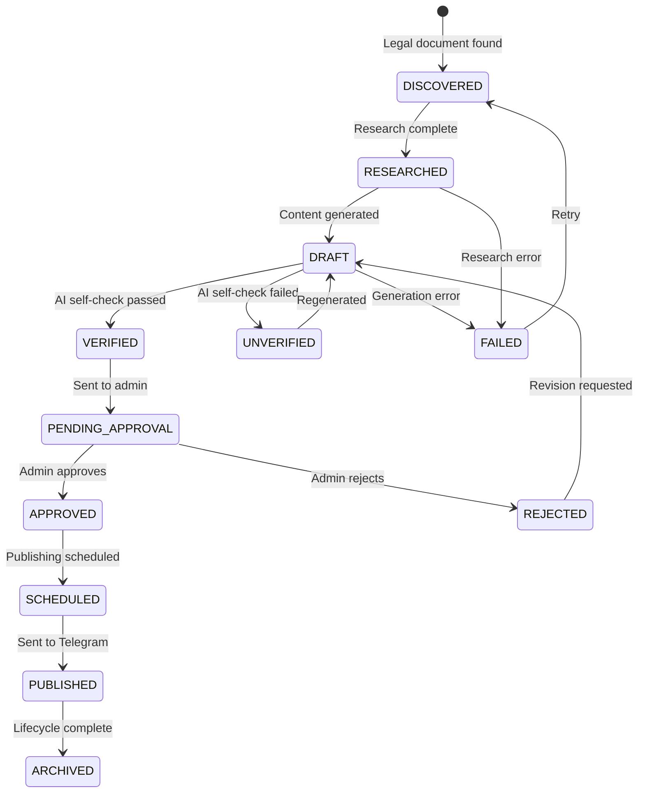
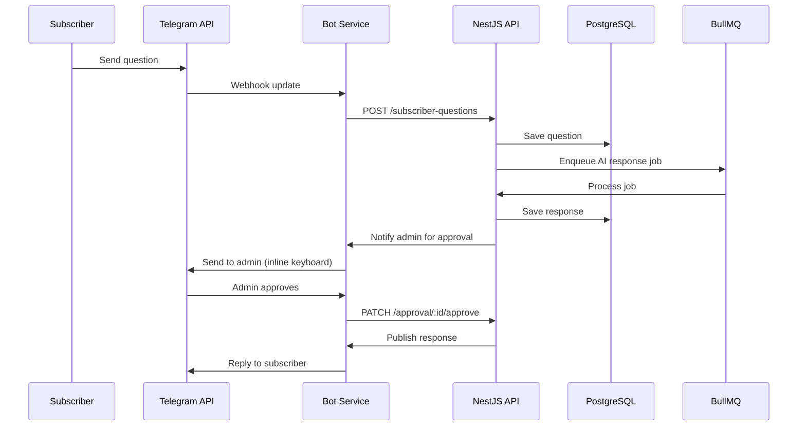
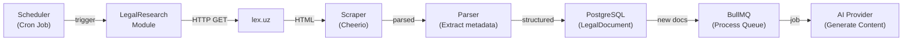
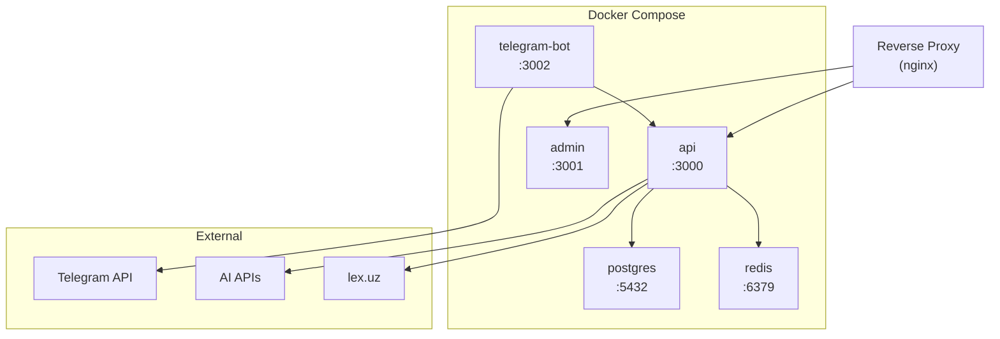

# Legal Aid AI — System Architecture

## 1. Architecture Overview

Legal Aid AI follows a **modular monorepo architecture** with clear separation of concerns. The system is composed of three deployable applications, three shared packages, and supporting infrastructure.



---

## 2. Monorepo Structure

```
legal-aid-ai/
├── apps/
│   ├── api/                        # NestJS backend API
│   │   ├── src/
│   │   │   ├── modules/            # Feature modules (17 modules)
│   │   │   ├── common/             # Guards, filters, interceptors, pipes
│   │   │   ├── config/             # Configuration module
│   │   │   ├── database/           # Prisma service & module
│   │   │   ├── app.module.ts
│   │   │   └── main.ts
│   │   ├── prisma/
│   │   │   ├── schema.prisma       # Database schema
│   │   │   ├── migrations/         # Database migrations
│   │   │   └── seed.ts             # Database seeder
│   │   ├── test/
│   │   ├── nest-cli.json
│   │   ├── tsconfig.json
│   │   └── package.json
│   │
│   ├── admin/                      # Next.js admin dashboard
│   │   ├── src/
│   │   │   ├── app/                # App Router pages
│   │   │   ├── components/         # UI components
│   │   │   ├── lib/                # Utilities & API client
│   │   │   └── hooks/              # Custom React hooks
│   │   ├── public/
│   │   ├── tailwind.config.ts
│   │   ├── next.config.js
│   │   ├── tsconfig.json
│   │   └── package.json
│   │
│   └── telegram-bot/               # Standalone Telegram bot service
│       ├── src/
│       │   ├── scenes/             # Telegraf scenes (conversation flows)
│       │   ├── handlers/           # Message & callback handlers
│       │   ├── keyboards/          # Inline & reply keyboards
│       │   ├── middleware/         # Bot middleware
│       │   ├── bot.module.ts
│       │   └── main.ts
│       ├── tsconfig.json
│       └── package.json
│
├── packages/
│   ├── shared/                     # Shared types, DTOs, constants
│   │   ├── src/
│   │   │   ├── types/              # TypeScript interfaces & enums
│   │   │   ├── dto/                # Shared Zod schemas & DTOs
│   │   │   ├── constants/          # Shared constants
│   │   │   └── utils/              # Shared utility functions
│   │   ├── tsconfig.json
│   │   └── package.json
│   │
│   ├── ai/                         # AI provider abstraction layer
│   │   ├── src/
│   │   │   ├── providers/          # Gemini, Claude implementations
│   │   │   ├── prompts/            # Prompt templates (Uzbek)
│   │   │   ├── interfaces/         # Provider interfaces
│   │   │   └── index.ts
│   │   ├── tsconfig.json
│   │   └── package.json
│   │
│   └── legal-research/             # Legal document research engine
│       ├── src/
│       │   ├── scrapers/           # lex.uz scraper
│       │   ├── parsers/            # Document parsers
│       │   ├── interfaces/         # Research interfaces
│       │   └── index.ts
│       ├── tsconfig.json
│       └── package.json
│
├── docs/                           # Project documentation
├── docker/                         # Docker configurations
│   ├── api.Dockerfile
│   ├── admin.Dockerfile
│   ├── bot.Dockerfile
│   └── docker-compose.yml
│
├── .env.example
├── .gitignore
├── turbo.json                      # Turborepo pipeline config
├── pnpm-workspace.yaml             # pnpm workspace definition
├── tsconfig.base.json              # Shared TypeScript config
├── package.json                    # Root package.json
└── README.md
```

---

## 3. Module Breakdown

The NestJS API is composed of **17 feature modules**, each encapsulating a specific domain:

### 3.1 Module Overview

| # | Module | Responsibility | Key Dependencies |
|---|--------|---------------|------------------|
| 1 | **AuthModule** | JWT authentication, login, token refresh | Users, Passport |
| 2 | **UsersModule** | Admin user CRUD, role management | Prisma |
| 3 | **TelegramModule** | Telegram Bot API integration, webhook handling | Telegraf, Publishing |
| 4 | **AIProviderModule** | AI provider abstraction (Gemini/Claude) | @legal-aid/ai |
| 5 | **LegalResearchModule** | Legal document discovery & research from lex.uz | @legal-aid/legal-research |
| 6 | **NewsModule** | Legal news management and processing | LegalResearch, AI |
| 7 | **EducationalContentModule** | Article generation and management | AI, LegalResearch |
| 8 | **CaseStudyModule** | Case study generation and management | AI, LegalResearch |
| 9 | **QuizModule** | Quiz generation with answers and explanations | AI, LegalResearch |
| 10 | **MediaModule** | Image/infographic generation and storage | AI, ImageProvider |
| 11 | **SubscriberQuestionsModule** | Process and respond to user-submitted questions | Telegram, AI |
| 12 | **ApprovalModule** | Content approval workflow engine | Telegram, Users |
| 13 | **PublishingModule** | Content formatting and Telegram publishing | Telegram |
| 14 | **SchedulerModule** | Cron-based task scheduling (discovery, publishing) | BullMQ, all content modules |
| 15 | **AnalyticsModule** | Content performance, engagement tracking | Prisma |
| 16 | **AuditModule** | Action logging and audit trail | Prisma |
| 17 | **SettingsModule** | Dynamic system configuration | Prisma, Redis |

### 3.2 Module Dependency Graph



---

## 4. Database Architecture

### 4.1 Database Engine

- **PostgreSQL 15+** as the primary relational database
- **Prisma ORM** for type-safe queries, migrations, and schema management
- Connection pooling via PgBouncer in production

### 4.2 Entity-Relationship Diagram

```mermaid
erDiagram
    User ||--o{ AuditLog : creates
    User ||--o{ ApprovalAction : performs
    
    LegalDocument ||--o{ NewsItem : references
    LegalDocument ||--o{ CaseStudy : references
    LegalDocument ||--o{ Quiz : references
    
    NewsItem ||--o{ ContentVersion : has
    NewsItem ||--o{ ApprovalAction : receives
    
    EducationalArticle ||--o{ ContentVersion : has
    EducationalArticle ||--o{ ApprovalAction : receives
    
    CaseStudy ||--o{ ContentVersion : has
    CaseStudy ||--o{ ApprovalAction : receives
    
    Quiz ||--|{ QuizOption : contains
    Quiz ||--o{ ApprovalAction : receives
    
    SubscriberQuestion ||--o| QuestionResponse : has
    
    PublishedPost ||--o{ PostAnalytics : tracks

    User {
        string id PK
        string email UK
        string passwordHash
        enum role
        boolean isActive
        datetime createdAt
    }

    LegalDocument {
        string id PK
        string sourceUrl UK
        string documentNumber
        string title
        string titleUz
        text rawContent
        enum documentType
        enum status
        datetime publishedDate
        datetime discoveredAt
    }

    NewsItem {
        string id PK
        string legalDocumentId FK
        string titleUz
        text summaryUz
        text bodyUz
        text bodyHtml
        enum status
        string[] hashtags
        datetime createdAt
    }

    EducationalArticle {
        string id PK
        string legalDocumentId FK
        string titleUz
        text contentUz
        text contentHtml
        enum contentType
        enum status
        string[] hashtags
        datetime createdAt
    }

    CaseStudy {
        string id PK
        string legalDocumentId FK
        string titleUz
        text scenarioUz
        text analysisUz
        text conclusionUz
        enum status
        datetime createdAt
    }

    Quiz {
        string id PK
        string legalDocumentId FK
        string questionUz
        text explanationUz
        int correctOptionIndex
        enum status
        datetime createdAt
    }

    QuizOption {
        string id PK
        string quizId FK
        int index
        string textUz
    }

    Media {
        string id PK
        string contentId
        enum contentType
        string url
        string altTextUz
        enum mediaType
        json metadata
        datetime createdAt
    }

    SubscriberQuestion {
        string id PK
        bigint telegramUserId
        string username
        text questionText
        enum status
        datetime receivedAt
    }

    QuestionResponse {
        string id PK
        string questionId FK
        text responseUz
        string approvedById FK
        enum status
        datetime createdAt
    }

    ContentVersion {
        string id PK
        string contentId
        enum contentType
        int version
        json snapshot
        string createdById FK
        datetime createdAt
    }

    ApprovalAction {
        string id PK
        string contentId
        enum contentType
        string userId FK
        enum action
        text comment
        datetime createdAt
    }

    PublishedPost {
        string id PK
        string contentId
        enum contentType
        int telegramMessageId
        string channelId
        datetime publishedAt
    }

    PostAnalytics {
        string id PK
        string publishedPostId FK
        int views
        int forwards
        int reactions
        datetime recordedAt
    }

    ScheduledTask {
        string id PK
        string name
        string cronExpression
        boolean isActive
        datetime lastRunAt
        datetime nextRunAt
    }

    Setting {
        string id PK
        string key UK
        json value
        string description
        datetime updatedAt
    }

    AuditLog {
        string id PK
        string userId FK
        string action
        string entityType
        string entityId
        json metadata
        string ipAddress
        datetime createdAt
    }
```



### 4.3 Model Summary

| # | Model | Description | Key Fields |
|---|-------|-------------|------------|
| 1 | `User` | Admin users with RBAC | email, role, passwordHash |
| 2 | `LegalDocument` | Raw legal documents from lex.uz | sourceUrl, documentNumber, rawContent |
| 3 | `NewsItem` | Generated news articles | titleUz, summaryUz, bodyUz, status |
| 4 | `EducationalArticle` | Educational content pieces | titleUz, contentUz, contentType, status |
| 5 | `CaseStudy` | Practical case studies | scenarioUz, analysisUz, conclusionUz |
| 6 | `Quiz` | Interactive quiz questions | questionUz, correctOptionIndex, explanationUz |
| 7 | `QuizOption` | Quiz answer options | textUz, index |
| 8 | `Media` | Images and infographic assets | url, altTextUz, mediaType |
| 9 | `SubscriberQuestion` | User-submitted questions | telegramUserId, questionText |
| 10 | `QuestionResponse` | AI-generated answers | responseUz, status |
| 11 | `ContentVersion` | Version history for all content | snapshot, version |
| 12 | `ApprovalAction` | Approval/rejection records | action, comment |
| 13 | `PublishedPost` | Published Telegram posts | telegramMessageId, channelId |
| 14 | `PostAnalytics` | Engagement metrics per post | views, forwards, reactions |
| 15 | `ScheduledTask` | Configurable scheduled jobs | cronExpression, isActive |
| 16 | `Setting` | Dynamic key-value configuration | key, value |
| 17 | `AuditLog` | Complete audit trail | action, entityType, metadata |

---

## 5. AI Provider Abstraction

The system uses a **Strategy Pattern** to support multiple AI providers interchangeably.

### 5.1 Provider Interface

```typescript
interface IAIProvider {
  generateText(prompt: string, options?: GenerateOptions): Promise<AIResponse>;
  generateStructured<T>(prompt: string, schema: ZodSchema<T>, options?: GenerateOptions): Promise<T>;
  summarize(text: string, options?: SummarizeOptions): Promise<string>;
  translate(text: string, from: string, to: string): Promise<string>;
}

interface GenerateOptions {
  maxTokens?: number;
  temperature?: number;
  systemPrompt?: string;
  timeout?: number;
}

interface AIResponse {
  content: string;
  usage: { inputTokens: number; outputTokens: number };
  model: string;
  finishReason: string;
}
```

### 5.2 Provider Configuration

```
AI_PROVIDER=gemini        # or 'claude'
AI_MODEL=gemini-2.0-flash # or 'claude-3-5-sonnet-20241022'
AI_MAX_TOKENS=4096
AI_TEMPERATURE=0.7
AI_TIMEOUT_MS=30000
AI_MAX_RETRIES=3
```

The active provider is selected at runtime based on `AI_PROVIDER` env variable. The `AIProviderModule` registers the appropriate implementation via a factory provider:

```typescript
@Module({
  providers: [
    {
      provide: AI_PROVIDER_TOKEN,
      useFactory: (config: ConfigService) => {
        const provider = config.get('AI_PROVIDER');
        return provider === 'claude'
          ? new ClaudeProvider(config)
          : new GeminiProvider(config);
      },
      inject: [ConfigService],
    },
  ],
  exports: [AI_PROVIDER_TOKEN],
})
export class AIProviderModule {}
```

---

## 6. Content Lifecycle

All generated content follows a strict state machine:



### State Descriptions

| State | Description |
|-------|-------------|
| `DISCOVERED` | Legal document or topic has been identified |
| `RESEARCHED` | Document has been scraped, parsed, and enriched |
| `DRAFT` | AI-generated content is available |
| `VERIFIED` | Content passed automated quality checks |
| `UNVERIFIED` | Content failed automated quality checks |
| `PENDING_APPROVAL` | Awaiting admin review via Telegram or dashboard |
| `APPROVED` | Admin has approved for publishing |
| `REJECTED` | Admin has rejected with optional feedback |
| `SCHEDULED` | Queued for future publishing |
| `PUBLISHED` | Successfully posted to Telegram |
| `FAILED` | An error occurred during processing |
| `ARCHIVED` | Content lifecycle complete, retained for analytics |

---

## 7. Security Architecture

### 7.1 Authentication

- **JWT-based authentication** for API and admin dashboard
- Access tokens (short-lived, 15min default) + Refresh tokens (long-lived, 7d)
- Password hashing via **bcrypt** (salt rounds: 12)
- Telegram bot authenticates admins via Telegram user IDs

### 7.2 Role-Based Access Control (RBAC)

| Role | Permissions |
|------|-------------|
| `SUPER_ADMIN` | Full system access, user management, settings |
| `ADMIN` | Content management, approval, publishing |
| `EDITOR` | Content review, limited approval |
| `VIEWER` | Read-only dashboard access |

```typescript
enum UserRole {
  SUPER_ADMIN = 'SUPER_ADMIN',
  ADMIN = 'ADMIN',
  EDITOR = 'EDITOR',
  VIEWER = 'VIEWER',
}
```

### 7.3 Authorization Guards

```typescript
@UseGuards(JwtAuthGuard, RolesGuard)
@Roles(UserRole.ADMIN, UserRole.SUPER_ADMIN)
@Controller('approval')
export class ApprovalController { ... }
```

### 7.4 Audit Logging

Every state-changing action is recorded in the `AuditLog` table:

- **Who**: User ID / System
- **What**: Action type (CREATE, UPDATE, DELETE, APPROVE, REJECT, PUBLISH)
- **Which**: Entity type + Entity ID
- **When**: Timestamp
- **Where**: IP address (for API requests)
- **Context**: JSON metadata with before/after state

### 7.5 API Security

- Rate limiting via `@nestjs/throttler`
- Input validation via Zod schemas + `ValidationPipe`
- CORS configured for admin dashboard origin
- Helmet for HTTP security headers
- Telegram webhook verification via secret token

---

## 8. Integration Architecture

### 8.1 Telegram Bot API



### 8.2 Telegram Interactions

| Feature | Method |
|---------|--------|
| **Webhook** | Bot receives updates via webhook (production) |
| **Long Polling** | Fallback for development |
| **Inline Keyboards** | Admin approval buttons (✅ Approve / ❌ Reject) |
| **Channel Posts** | Publishing to @Huquq_study |
| **Message Formatting** | MarkdownV2 for rich content |
| **Media Groups** | Grouped images for infographic posts |

### 8.3 Legal Source Integration (lex.uz)



### 8.4 AI Provider Integration

- All AI calls go through the `@legal-aid/ai` package
- Requests include Uzbek language system prompts
- Structured output uses Zod schemas for validation
- Retry logic with exponential backoff
- Token usage tracked per request
- Timeout protection (configurable, default 30s)

---

## 9. Queue & Background Processing

### 9.1 BullMQ Queues

| Queue | Purpose | Concurrency |
|-------|---------|-------------|
| `legal-discovery` | Scrape lex.uz for new documents | 1 |
| `legal-research` | Deep-research discovered documents | 2 |
| `content-generation` | Generate articles, quizzes, case studies | 3 |
| `media-generation` | Generate images/infographics | 2 |
| `content-publishing` | Publish approved content to Telegram | 1 |
| `analytics-collection` | Collect post engagement metrics | 1 |
| `subscriber-questions` | Process subscriber Q&A | 2 |

### 9.2 Job Processing

- Jobs are persistent (stored in Redis)
- Failed jobs are retried with exponential backoff
- Dead letter queue for permanently failed jobs
- Job progress tracking for long-running operations
- Priority queues for urgent content

---

## 10. Caching Strategy

| Data | Cache TTL | Strategy |
|------|-----------|----------|
| User sessions | 15 min | Write-through |
| Settings | 5 min | Cache-aside |
| Published posts | 1 hour | Cache-aside |
| AI responses | No cache | N/A (unique per request) |
| Legal document metadata | 30 min | Cache-aside |
| Analytics aggregates | 10 min | Cache-aside |

---

## 11. Deployment Architecture



### Container Configuration

| Service | Port | Resources |
|---------|------|-----------|
| `api` | 3000 | 512MB RAM, 0.5 CPU |
| `admin` | 3001 | 256MB RAM, 0.25 CPU |
| `telegram-bot` | 3002 | 256MB RAM, 0.25 CPU |
| `postgres` | 5432 | 1GB RAM, 1 CPU |
| `redis` | 6379 | 256MB RAM, 0.25 CPU |
