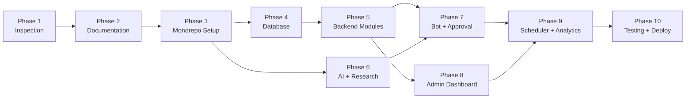

# Legal Aid AI — Implementation Plan

## Overview

This document outlines the **10-phase implementation plan** for the Legal Aid AI platform. Each phase builds upon the previous one, ensuring a stable and tested foundation at every step.

**Estimated Total Duration**: 8-12 weeks

---

## Phase Summary

| Phase | Name | Status | Description |
|-------|------|--------|-------------|
| 1 | Workspace Inspection | ✅ Done | Analyze environment, verify prerequisites |
| 2 | Documentation | 🔄 Current | Create project specifications and architecture docs |
| 3 | Monorepo Setup | ⬜ Pending | Initialize workspace, configure tooling |
| 4 | Database Models | ⬜ Pending | Define Prisma schema, run migrations |
| 5 | Backend Modules | ⬜ Pending | Implement core NestJS modules |
| 6 | AI Provider + Legal Research | ⬜ Pending | AI abstraction layer and lex.uz integration |
| 7 | Telegram Bot + Approval Workflow | ⬜ Pending | Bot setup, approval pipeline |
| 8 | Admin Dashboard | ⬜ Pending | Next.js admin panel |
| 9 | Scheduler + Analytics | ⬜ Pending | Automated jobs, metrics collection |
| 10 | Testing + Deployment | ⬜ Pending | Test coverage, Docker, CI/CD |

---

## Phase 1: Workspace Inspection ✅

**Status**: Complete

### Objectives
- [x] Verify Node.js version (v18+ required)
- [x] Verify pnpm availability
- [x] Verify Git configuration
- [x] Verify Docker and Docker Compose
- [x] Inspect existing workspace contents
- [x] Document system environment

### Outputs
- Environment assessment report
- Confirmed tool versions and availability

---

## Phase 2: Documentation 🔄

**Status**: In Progress

### Objectives
- [x] Create `docs/PROJECT_SPECIFICATION.md`
- [x] Create `docs/ARCHITECTURE.md`
- [x] Create `docs/IMPLEMENTATION_PLAN.md`
- [x] Create `.env.example`
- [x] Create `README.md`

### Outputs
- Complete project documentation suite
- Environment variable template
- Professional README

---

## Phase 3: Monorepo Setup ⬜

**Status**: Pending

### Objectives
- [ ] Initialize root `package.json` with pnpm workspaces
- [ ] Create `pnpm-workspace.yaml`
- [ ] Configure Turborepo (`turbo.json`)
- [ ] Create shared `tsconfig.base.json` with strict mode
- [ ] Scaffold `apps/api` — NestJS application
- [ ] Scaffold `apps/admin` — Next.js application
- [ ] Scaffold `apps/telegram-bot` — NestJS standalone bot
- [ ] Scaffold `packages/shared` — Types, DTOs, constants
- [ ] Scaffold `packages/ai` — AI provider abstraction
- [ ] Scaffold `packages/legal-research` — lex.uz integration
- [ ] Configure ESLint + Prettier (shared config)
- [ ] Create `.gitignore`
- [ ] Create Docker configuration files
- [ ] Verify `pnpm install` and `turbo build` succeed

### Key Decisions
- **Package Manager**: pnpm (strict, efficient for monorepos)
- **Build System**: Turborepo (parallel builds, caching)
- **TypeScript**: Strict mode, project references
- **Node.js Target**: ES2022

### Deliverables

```
legal-aid-ai/
├── apps/api/           ← NestJS skeleton with AppModule
├── apps/admin/         ← Next.js skeleton with App Router
├── apps/telegram-bot/  ← NestJS bot skeleton
├── packages/shared/    ← Exported types & utilities
├── packages/ai/        ← AI provider interfaces
├── packages/legal-research/ ← Research interfaces
├── turbo.json
├── pnpm-workspace.yaml
├── tsconfig.base.json
├── .eslintrc.js
├── .prettierrc
└── .gitignore
```

---

## Phase 4: Database Models ⬜

**Status**: Pending

### Objectives
- [ ] Define complete Prisma schema (`schema.prisma`) with all 17+ models
- [ ] Configure PostgreSQL connection with connection pooling
- [ ] Generate initial migration
- [ ] Create database seeder (`seed.ts`) with:
  - Default SUPER_ADMIN user
  - Default system settings
  - Sample legal document data
- [ ] Generate Prisma client
- [ ] Create `PrismaService` as NestJS provider
- [ ] Create `PrismaModule` (global)
- [ ] Verify schema with `prisma validate`

### Models to Define (19 total)

| # | Model | Priority |
|---|-------|----------|
| 1 | User | High |
| 2 | LegalDocument | High |
| 3 | NewsItem | High |
| 4 | EducationalArticle | High |
| 5 | CaseStudy | Medium |
| 6 | Quiz | Medium |
| 7 | QuizOption | Medium |
| 8 | Media | Medium |
| 9 | SubscriberQuestion | Medium |
| 10 | QuestionResponse | Medium |
| 11 | ContentVersion | Medium |
| 12 | ApprovalAction | High |
| 13 | PublishedPost | High |
| 14 | PostAnalytics | Low |
| 15 | ScheduledTask | Medium |
| 16 | Setting | High |
| 17 | AuditLog | High |
| 18 | RefreshToken | High |
| 19 | Session | Medium |

### Key Decisions
- UUIDs for all primary keys (`@default(uuid())`)
- `createdAt` / `updatedAt` on all models
- Soft deletes where appropriate
- Proper indexes for common query patterns
- Enum types for status fields

---

## Phase 5: Backend Modules ⬜

**Status**: Pending

### Objectives
Implement the following NestJS modules with full CRUD operations:

#### 5.1 Core Infrastructure
- [ ] **ConfigModule** — Environment validation with Zod, typed config
- [ ] **AuthModule** — JWT strategy, login/register, refresh tokens, guards
- [ ] **UsersModule** — CRUD, role management, password hashing
- [ ] **AuditModule** — Audit log interceptor, query API

#### 5.2 Content Modules
- [ ] **NewsModule** — CRUD, status transitions, content versioning
- [ ] **EducationalContentModule** — Article CRUD, content types
- [ ] **CaseStudyModule** — Case study CRUD
- [ ] **QuizModule** — Quiz CRUD with options management
- [ ] **MediaModule** — File upload, image storage, metadata

#### 5.3 Workflow Modules
- [ ] **ApprovalModule** — Approval workflow engine, state machine
- [ ] **PublishingModule** — Telegram message formatting, publishing

#### 5.4 System Modules
- [ ] **SettingsModule** — Dynamic key-value settings with caching
- [ ] **AnalyticsModule** — Aggregation queries, reporting endpoints

### Shared Infrastructure
- [ ] Global exception filter with structured error responses
- [ ] Request validation pipe (Zod-based)
- [ ] Response serialization interceptor
- [ ] Logging interceptor
- [ ] Rate limiting guard
- [ ] Health check endpoint

### API Documentation
- [ ] Swagger/OpenAPI setup via `@nestjs/swagger`

---

## Phase 6: AI Provider + Legal Research ⬜

**Status**: Pending

### Objectives

#### 6.1 AI Provider Package (`packages/ai`)
- [ ] Define `IAIProvider` interface
- [ ] Implement `GeminiProvider` using Google Generative AI SDK
- [ ] Implement `ClaudeProvider` using Anthropic SDK
- [ ] Create prompt templates for all content types (in Uzbek):
  - Legal news article generation
  - Case study generation
  - Quiz generation
  - Subscriber question answering
  - Content summarization
  - Content quality verification
- [ ] Implement structured output with Zod schema validation
- [ ] Add retry logic with exponential backoff
- [ ] Token usage tracking
- [ ] Unit tests for providers

#### 6.2 Legal Research Package (`packages/legal-research`)
- [ ] Implement lex.uz scraper (Cheerio-based)
- [ ] Parse document metadata (number, date, type, category)
- [ ] Extract document body content
- [ ] Handle pagination for document listings
- [ ] Rate limiting and polite scraping
- [ ] Cache scraped content
- [ ] Unit tests for scrapers and parsers

#### 6.3 NestJS Integration
- [ ] **AIProviderModule** — Register provider factory, expose as service
- [ ] **LegalResearchModule** — Discovery service, research pipeline

### Prompt Template Example

```typescript
const ARTICLE_GENERATION_PROMPT = `
Siz O'zbekiston qonunchiligi bo'yicha tajribali huquqshunos va ta'lim kontentini tayyorlovchi mutaxassissiz.

Quyidagi huquqiy hujjat asosida @Huquq_study Telegram kanali uchun ta'limiy maqola yozing:

HUJJAT: {document}

TALABLAR:
1. Maqola o'zbek tilida (lotin yozuvida) yozilsin
2. Oddiy fuqarolar uchun tushunarli tilda yozilsin
3. Qonunning asosiy bandlarini tushuntiring
4. Amaliy ta'sirini ko'rsating
5. Lex.uz dagi asl hujjatga havola qo'shing

FORMAT:
- Sarlavha (emoji bilan)
- Qisqacha xulosa (2-3 gap)
- Asosiy matn (3-5 band)
- Xulosa
- Teglar (#huquq #qonun ...)
`;
```

---

## Phase 7: Telegram Bot + Approval Workflow ⬜

**Status**: Pending

### Objectives

#### 7.1 Telegram Bot (`apps/telegram-bot`)
- [ ] Configure Telegraf with webhook support
- [ ] Implement bot commands:
  - `/start` — Welcome message and bot description
  - `/help` — Available commands
  - `/savol` — Submit a legal question
  - `/admin` — Admin panel (restricted)
- [ ] Implement subscriber question handler
- [ ] Create inline keyboards for admin approval:
  - ✅ Tasdiqlash (Approve)
  - ❌ Rad etish (Reject)
  - ✏️ Tahrirlash (Edit)
  - 📋 Batafsil (Details)
- [ ] Implement callback query handlers
- [ ] Content formatting for Telegram (MarkdownV2)
- [ ] Media group publishing for infographics
- [ ] Error handling and user-friendly error messages (in Uzbek)

#### 7.2 Approval Workflow
- [ ] Send content previews to admin group/DM
- [ ] Inline keyboard for approve/reject with comments
- [ ] Multi-admin support (configurable admin IDs)
- [ ] Approval notification flow:
  1. Content generated → Admin notified
  2. Admin reviews via Telegram or dashboard
  3. Admin approves/rejects with optional comment
  4. Status updated, content queued for publishing or returned to draft
- [ ] Approval timeout handling (auto-remind after 24h)

#### 7.3 Publishing Pipeline
- [ ] Format content for Telegram MarkdownV2
- [ ] Handle message length limits (4096 chars)
- [ ] Split long content into multiple messages
- [ ] Attach media (images, infographics)
- [ ] Schedule publishing with configurable delays
- [ ] Track published message IDs for analytics

### Telegram Message Format Example

```
📜 YANGI QONUN

O'zbekiston Respublikasi Prezidentining
"Tadbirkorlik faoliyatini yanada qo'llab-quvvatlash
to'g'risida"gi Farmoni

📌 Asosiy o'zgarishlar:

1️⃣ Kichik biznes uchun soliq imtiyozlari
2️⃣ Ro'yxatdan o'tish tartibining soddalashtirilishi
3️⃣ Kredit olish shartlarining yengillashtirishi

🔗 To'liq matn: lex.uz/docs/12345

#huquq #tadbirkorlik #qonun #yangilik

📚 @Huquq_study
```

---

## Phase 8: Admin Dashboard ⬜

**Status**: Pending

### Objectives
- [ ] Set up Next.js 14 with App Router
- [ ] Configure Tailwind CSS + shadcn/ui
- [ ] Implement authentication pages (login, password reset)
- [ ] Dashboard layout with sidebar navigation

#### Pages
| Page | Route | Description |
|------|-------|-------------|
| Dashboard | `/` | Overview stats, recent activity |
| Legal Documents | `/documents` | Discovered documents list |
| News | `/news` | News articles management |
| Articles | `/articles` | Educational articles |
| Case Studies | `/case-studies` | Case study management |
| Quizzes | `/quizzes` | Quiz management |
| Approval Queue | `/approval` | Pending content review |
| Subscriber Q&A | `/questions` | Subscriber questions |
| Analytics | `/analytics` | Performance charts |
| Users | `/users` | Admin user management |
| Settings | `/settings` | System configuration |
| Audit Log | `/audit` | Activity log viewer |

#### Key Features
- [ ] Real-time approval queue with WebSocket updates
- [ ] Content preview matching Telegram format
- [ ] Side-by-side editing (Uzbek text + preview)
- [ ] Analytics charts (recharts)
- [ ] Responsive design for mobile admin use
- [ ] Dark mode support
- [ ] Uzbek language UI labels

---

## Phase 9: Scheduler + Analytics ⬜

**Status**: Pending

### Objectives

#### 9.1 Scheduler Module
- [ ] Configure BullMQ queues and workers
- [ ] Implement scheduled tasks:

| Task | Default Schedule | Description |
|------|-----------------|-------------|
| `discover-legal-docs` | Every 2 hours | Scan lex.uz for new documents |
| `process-research-queue` | Every 30 min | Research discovered documents |
| `generate-content` | Every hour | Generate content from researched docs |
| `publish-scheduled` | 09:00, 13:00, 18:00 | Publish approved content |
| `collect-analytics` | Every 6 hours | Gather Telegram post metrics |
| `process-questions` | Every 15 min | Process subscriber question queue |
| `cleanup-old-jobs` | Daily at 03:00 | Remove completed/failed jobs |

- [ ] Admin-configurable schedules via Settings
- [ ] Job monitoring dashboard integration
- [ ] Dead letter queue handling
- [ ] Job retry policies

#### 9.2 Analytics Module
- [ ] Collect Telegram post metrics via Bot API:
  - Message views
  - Forwards
  - Reactions
  - Reply counts
- [ ] Aggregate analytics:
  - Content published per day/week/month
  - Average engagement rate
  - Best performing content types
  - Subscriber question trends
  - AI generation success/failure rates
  - Approval rate and turnaround time
- [ ] Analytics API endpoints for dashboard
- [ ] Exportable reports (CSV)

---

## Phase 10: Testing + Deployment ⬜

**Status**: Pending

### Objectives

#### 10.1 Testing
- [ ] Unit tests for all services (Jest)
- [ ] Integration tests for API endpoints (supertest)
- [ ] E2E tests for critical workflows:
  - Content discovery → generation → approval → publishing
  - Subscriber question → response → approval → reply
  - Admin authentication → authorization flow
- [ ] AI provider mock for deterministic tests
- [ ] Database test fixtures
- [ ] Minimum 80% code coverage target

#### 10.2 Docker & Docker Compose
- [ ] Multi-stage Dockerfiles for each app:
  - `docker/api.Dockerfile`
  - `docker/admin.Dockerfile`
  - `docker/bot.Dockerfile`
- [ ] `docker-compose.yml` with all services:
  - api, admin, telegram-bot
  - postgres (with volume)
  - redis (with volume)
- [ ] `docker-compose.dev.yml` for development overrides
- [ ] Health checks for all services
- [ ] Environment variable management

#### 10.3 CI/CD Documentation
- [ ] GitHub Actions workflow templates
- [ ] Build → Test → Lint → Type-check pipeline
- [ ] Deployment documentation
- [ ] Production environment checklist

#### 10.4 Documentation Finalization
- [ ] API documentation (Swagger/OpenAPI)
- [ ] Deployment guide
- [ ] Operations runbook
- [ ] Troubleshooting guide

---

## Risk Register

| Risk | Impact | Likelihood | Mitigation |
|------|--------|------------|------------|
| lex.uz structure changes | High | Medium | Modular scraper design, monitoring, fallback parsing |
| AI provider rate limits | Medium | Medium | Queue-based processing, retry logic, provider fallback |
| Telegram API changes | Medium | Low | Telegraf library handles most abstraction |
| AI content quality | High | Medium | Verification step, admin approval gate, prompt iteration |
| Database performance | Medium | Low | Proper indexing, query optimization, connection pooling |
| Cost overruns (AI API) | Medium | Medium | Token usage tracking, configurable limits, caching |

---

## Dependencies Between Phases



> **Note**: Phases 6 and 3 can be started concurrently. Phase 8 can begin as soon as Phase 5 API endpoints are available.
